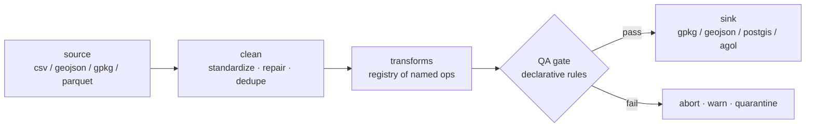

# geoetl — config-driven geospatial ETL


A small framework for geospatial data pipelines: **ingest → clean → transform → QA → load**,
declared in YAML, executed by tested Python. Built to replace the pile of one-off scripts
that every GIS shop accumulates, with one auditable pattern.

```yaml
# a pipeline is a config file, not a script
source:  { path: facilities_raw.csv, format: csv, x_field: LON, y_field: LAT, crs: EPSG:4326 }
clean:   { standardize_fields: true, repair_geometries: true, drop_duplicates: true }
transforms:
  - { op: spatial_join, right_path: districts.geojson, fields: [district] }
  - { op: reproject, crs: EPSG:3857 }
qa:
  on_fail: quarantine
  rules:
    - { kind: unique, field: facility_id }
    - { kind: in_set, field: facility_type, values: [clinic, hospital, health_post, pharmacy] }
    - { kind: geometry_valid }
sink:    { format: gpkg, path: out/facilities_clean.gpkg, layer: facilities }
```

## Quick start

```bash
pip install -e ".[dev]"
make demo        # runs the bundled example end-to-end and prints the QA report
make test        # 30+ unit and end-to-end tests
```

The bundled example dataset is synthetic and **deliberately dirty** — duplicate rows,
a null-island coordinate, domain typos, negative values, an invalid bowtie polygon —
because catching those is the pipeline's job. The end-to-end test asserts each one is caught.

## Architecture



### Decisions a reviewer should know about

- **Config over code.** Analysts author YAML; the framework owns correctness. Configs are
  validated eagerly and *every* error is reported at once — nobody fixes a config one
  KeyError at a time.
- **QA is a first-class stage, not an afterthought.** Rules are declarative, results are a
  structured report (rendered to markdown for humans), and the failure policy is explicit:
  `abort` for production loads, `quarantine` to keep good rows moving while bad rows land in
  a reviewable file.
- **Every stage logs what it changed.** "The pipeline dropped 14 rows" is an answer;
  "the pipeline did something" is not.
- **Guard rails for classic geo-bugs.** `buffer` and `add_area` refuse to run in a
  geographic CRS (a degree is not a distance); `within_bounds` exists to catch null-island
  and lat/lon-swap rows; geometry repair uses GEOS `make_valid`, not the `buffer(0)` folk
  remedy, and counts what it touched.
- **Heavy sinks are optional extras.** PostGIS and ArcGIS Online adapters live behind
  `pip install "geoetl[postgis]"` / `"geoetl[agol]"`, read credentials from the environment
  (never the config file), and the core test suite needs neither.
- **Transforms are a registry.** Adding one is a function + decorator; the CLI lists them
  (`geoetl transforms`), and unknown ops fail fast with the valid list.

## CLI

```bash
geoetl validate pipeline.yml     # check a config without running it
geoetl run pipeline.yml --qa-report out/qa.md
geoetl transforms                # list available ops
```

Exit codes: `0` success · `2` invalid config · `3` QA gate failed.

## Layout

```
src/geoetl/
  config.py     # typed, eagerly-validated pipeline config
  io.py         # readers + sinks (file formats; postgis/agol adapters)
  clean.py      # field standardization, geometry repair, dedupe (with audit log)
  transform.py  # registry of named transform ops
  qa.py         # declarative rule engine + report
  pipeline.py   # orchestration + failure policy
  cli.py
examples/       # runnable demo: dirty data + pipeline config
tests/          # unit + end-to-end (the example must run green in CI)
```

## License

MIT
